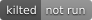
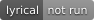

# duatic_cartographer_ros

[](https://github.com/Duatic/duatic_cartographer_ros/actions/workflows/ci.yml)
[](https://github.com/Duatic/duatic_cartographer_ros/actions/workflows/ci.yml)
[](https://github.com/Duatic/duatic_cartographer_ros/actions/workflows/ci.yml)
[](https://github.com/Duatic/duatic_cartographer_ros/actions/workflows/ci.yml)

This repository is the Duatic fork of [cartographer_ros](https://github.com/cartographer-project/cartographer_ros), the ROS integration of the [Cartographer](https://github.com/cartographer-project/cartographer) SLAM system. It is based on the ROS 2 port in [ros2/cartographer_ros](https://github.com/ros2/cartographer_ros) and builds against [duatic_cartographer](https://github.com/Duatic/duatic_cartographer).

| Package | Description |
| --- | --- |
| [cartographer_ros](./cartographer_ros) | Cartographer node, offline node, assets writer and launch files |
| [cartographer_ros_msgs](./cartographer_ros_msgs) | Messages and services of the Cartographer node |
| [cartographer_rviz](./cartographer_rviz) | RViz plugin to display submaps |

# Changes to upstream

- Rangefinder intensities from `LaserScan`, `MultiEchoLaserScan` and `PointCloud2` messages are forwarded to Cartographer, which is what `TRAJECTORY_BUILDER_2D.min_intensity` of duatic_cartographer filters on.

# Citation

If you use Cartographer in your research, please cite the original publication:

```bibtex
@inproceedings{hess2016realtime,
  author    = {Hess, Wolfgang and Kohler, Damon and Rapp, Holger and Andor, Daniel},
  title     = {Real-Time Loop Closure in {2D} {LIDAR} {SLAM}},
  booktitle = {2016 IEEE International Conference on Robotics and Automation (ICRA)},
  year      = {2016},
  pages     = {1271--1278}
}
```

# License

The contents are licensed under the Apache-2.0 [license](LICENSE). The copyright holders are listed in [AUTHORS](AUTHORS).

# Dependencies

All dependencies with their corresponding version are listed in the [repos.list](./repos.list).

| Name | Description | License
| ---  | --- | --- |
| [duatic_cartographer](https://github.com/Duatic/duatic_cartographer) | Duatic fork of the Cartographer SLAM library | Apache-2.0 |

# Usage

Clone this repository together with the dependencies in [repos.list](./repos.list) into the `src` folder of a ROS 2 workspace, for example with `vcs import src < repos.list`, and build it with `colcon build`.

Example launch files can be found in [cartographer_ros/launch](./cartographer_ros/launch), and example configurations in [cartographer_ros/configuration_files](./cartographer_ros/configuration_files).
For configuration and tuning please refer to the upstream [cartographer_ros documentation](https://google-cartographer-ros.readthedocs.io).

# Contributing

Please see the [Contributing guide](./CONTRIBUTING.md)
